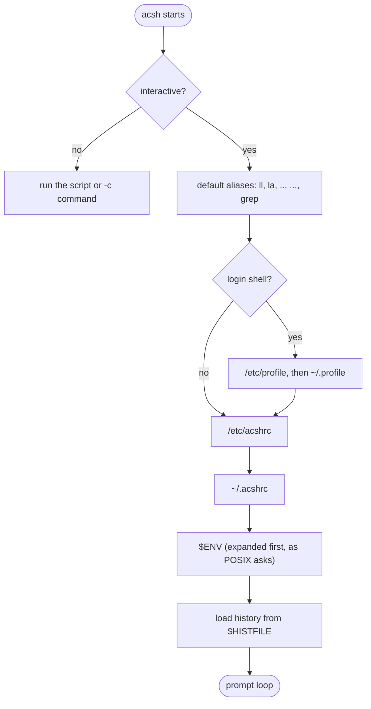
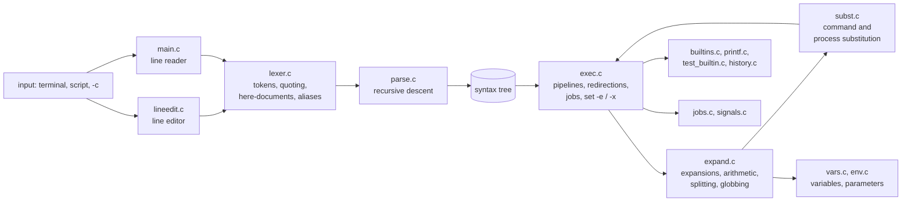
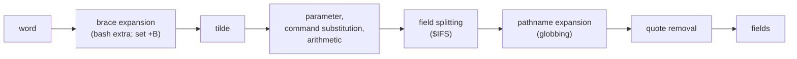
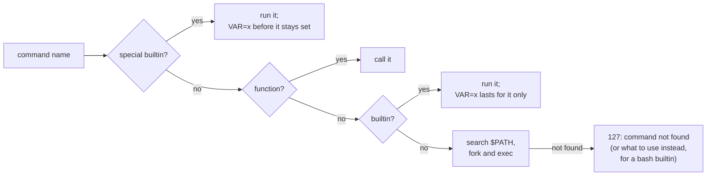
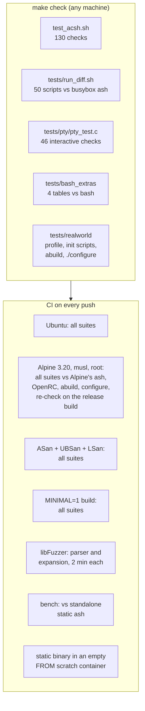
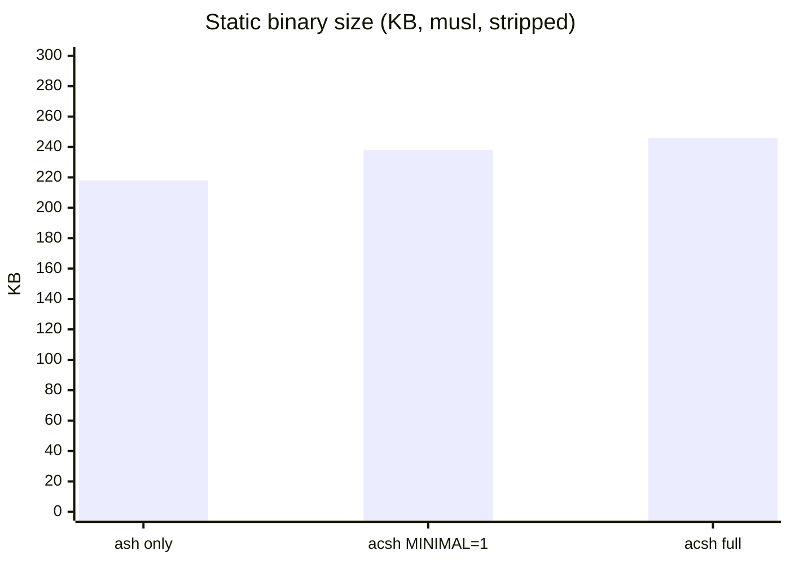
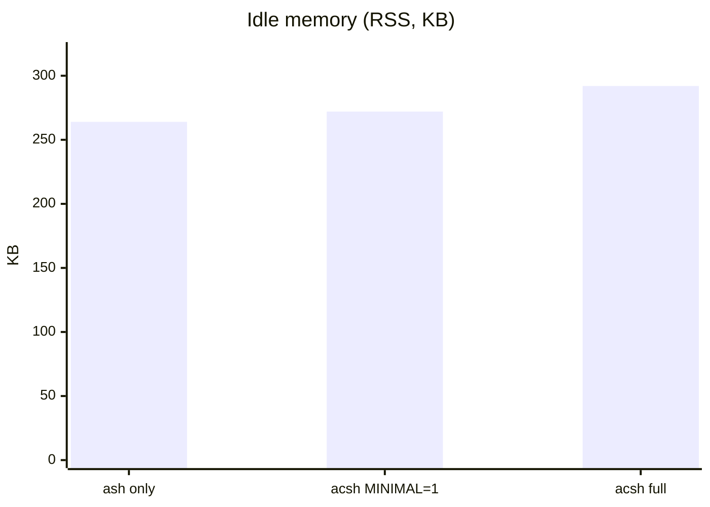
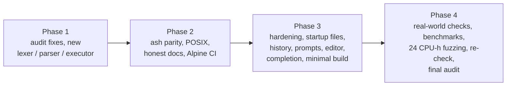

# acsh

**A small, fast POSIX shell in C: a drop-in alternative to BusyBox `ash`
that is also a comfortable interactive shell.**

acsh speaks `ash`'s language, ships the same builtins and gives the same
output, so scripts written for Alpine, BusyBox and other `/bin/sh`
systems run unchanged. On top of that it fixes a list of things `ash`
users keep running into: a real line editor with history search and
smart Tab completion, history that is not lost or corrupted, startup
files that work under `su` and `docker exec`, clear error messages, and
a core that does not crash on hostile input.

Every claim in this README points at the test or the measurement that
backs it. Behaviour is compared against BusyBox `ash` 1.37 locally, and
against the BusyBox 1.36 that Ubuntu and Alpine ship in CI.

| At a glance | |
|---|---|
| Language | POSIX.1-2024 shell command language, plus `ash`'s extensions ([POSIX report](docs/posix_compliance.md)) |
| Compatibility | 50 differential test scripts produce byte-identical output and exit status under acsh and `ash` |
| Interactive | emacs-style line editor, Ctrl-R, Tab completion, history suggestions, bash-style prompts with the git branch |
| Robustness | 24 CPU-hours of fuzzing with no crash; no crash on 100,000-deep nesting, 1 MB values or known `ash` CVE inputs |
| Size | about 120–130 KB of code; a static musl build is a single file with no dependencies |
| Startup | as fast as `ash` (1,000 runs of `-c true` in about the same time), faster with large environments |
| Dependencies | a C11 compiler and `make`; tests also need BusyBox |

---

## Contents

- [Quick start](#quick-start)
- [Invocation](#invocation)
- [Startup files](#startup-files)
- [Interactive use](#interactive-use)
  - [Line editor](#line-editor) · [Tab completion](#tab-completion) · [History](#history) · [Prompts](#prompts) · [Job control](#job-control)
- [The scripting language](#the-scripting-language)
- [Where acsh goes further than ash](#where-acsh-goes-further-than-ash)
- [Robustness and limits](#robustness-and-limits)
- [How acsh works](#how-acsh-works)
- [How it is tested](#how-it-is-tested)
- [Evidence](#evidence)
- [What ash still does better](#what-ash-still-does-better)
- [Building](#building)
- [Project layout](#project-layout)
- [Development](#development)
- [Roadmap](#roadmap)

---

## Quick start

Prebuilt binaries (static, for x86_64 and aarch64, with checksums) are on
the [Releases](https://github.com/aarushchaudhary/acsh/releases) page.
To build from source:

```sh
git clone <this repository> acsh && cd acsh
make                # one binary, ./acsh (gcc or clang, any libc)
./acsh              # an interactive shell
./acsh script.sh arg1 arg2
./acsh -c 'echo "$0 got $1"' name first
make check          # every test suite (needs busybox for the ash comparison)
```

Nothing is installed and your login shell is not changed by building.
To try acsh as your login shell, copy the binary somewhere on your
`PATH`, list it in `/etc/shells` and run `chsh -s /usr/local/bin/acsh`
(for a self-contained binary, see [`make static`](#building)).

To start from sensible interactive defaults:

```sh
cp config/acshrc.default ~/.acshrc
```

---

## Invocation

acsh takes the same options as `ash`:

```
acsh [options] -c COMMAND [NAME [ARG...]]   run COMMAND ($0 = NAME, $1... = ARGs)
acsh [options] FILE [ARG...]                run the script FILE
acsh [options] [-s] [ARG...]                read commands from standard input
```

| Option | Meaning | Test |
|---|---|---|
| `-c` | run the command string | test_acsh [2.22] |
| `-s` | read commands from standard input, with arguments | [2.22] |
| `-i` | interactive, even when input is not a terminal | [2.22] |
| `-l` | login shell (also when `argv[0]` starts with `-`, as `login` starts shells) | [2.23] |
| `-e -u -x -f -n -v -a -C -b -B` | any `set` option, as on the `set` command line | `set_options` |

Input is interactive (prompt, history, default aliases, startup files)
with `-i`, or when there is no `-c` or `FILE` and both standard input
and standard error are terminals. A missing script exits with status 2,
as in `ash`.

---

## Startup files

Every interactive shell, login or not, reads the same files, so a shell
started by `su`, `docker exec -it` or `lxc exec` gets your aliases. A
script never reads any of them, so it behaves the same for every user.



| Rule | Why | Test |
|---|---|---|
| each file runs at most once (by device and inode), so `ENV=~/.acshrc` does not run it twice | common setups point `ENV` at the rc file | `tests/pty` (startup) |
| a setuid shell (real and effective ids differ) reads none of them | a startup file must not run with someone else's rights | — |
| `PS1` is set only in interactive shells | profiles use `[ "$PS1" ]` to tell interactive shells from scripts | test_acsh [2.28] |
| `IFS` is reset to space, tab, newline at startup, never inherited | POSIX; an inherited `IFS` is a security problem | `builtins_env` |
| an unset `PATH` gets `ash`'s default `/sbin:/usr/sbin:/bin:/usr/bin` | commands still run from minimal environments | [2.28] |

---

## Interactive use

### Line editor

The editor runs the terminal in raw mode only while you type a line, so
programs you start always see a normal terminal. Lines wider than the
screen scroll sideways, and a prompt wider than half the screen is shown
shortened, so editing always has room. Without a terminal, or with
`TERM=dumb`, acsh reads plain lines.

| Keys | Action |
|---|---|
| Left / Right, Ctrl-B / Ctrl-F | move one character (UTF-8 aware) |
| Alt-B / Alt-F, Ctrl-Left / Ctrl-Right | move one word |
| Home / End, Ctrl-A / Ctrl-E | start / end of the line |
| Backspace, Delete | delete a character |
| Ctrl-U / Ctrl-K | cut to the start / to the end of the line |
| Ctrl-W, Alt-Backspace | cut the word before the cursor |
| Ctrl-Y | paste the last cut |
| Up / Down, Ctrl-P / Ctrl-N | previous / next history entry (the line being typed is kept) |
| Ctrl-R | incremental reverse history search (Ctrl-R again: older match; Ctrl-G: cancel) |
| Tab | complete (see below) |
| Right at the end of the line | accept the history suggestion (`set -o suggest`) |
| Ctrl-L | clear the screen |
| Ctrl-C | drop the line (status 130); on a continuation line, drop the whole command |
| Ctrl-D | delete a character, or end the shell on an empty line (not with `set -o ignoreeof`) |

All of these are replayed as keystrokes by `tests/pty/pty_test.c`
(the `lineedit` section, 23 checks).

### Tab completion

What Tab completes depends on where the cursor is:

| Where | Completes | Example |
|---|---|---|
| a word starting with `$` or `${` | variable names | `echo $PA` → `echo $PATH` |
| the command position (after `;` `\|` `&` `(` too) | commands in `$PATH`, builtins, aliases, functions, reserved words | `ech` → `echo ` |
| a command word containing `/` | executable files and directories | `./scr` → `./scripts/` |
| the argument of `cd` | directories only | `cd sr` → `cd src/` |
| the word after `apk` | `apk`'s subcommands | `apk upg` → `apk upgrade ` |
| anything else | files and directories, `~/` understood | `cat ~/Doc` → `cat ~/Documents/` |

One match is inserted whole, followed by a space (a `/` for a
directory). Several matches are extended to what they share; if that
adds nothing, they are listed under the line. Names with spaces or shell
characters are inserted escaped. (`tests/pty`, `complete` section.)

### History

| Feature | Details | Test |
|---|---|---|
| `$HISTFILE` | default `~/.acsh_history`, created with mode 0600; `HISTFILE=` keeps no file | test_acsh [3.3] |
| `$HISTSIZE` | entries kept in memory and in the file (default 1,000); the file is trimmed at exit | [3.3] |
| `$HISTCONTROL` | `ignorespace`, `ignoredups`, `ignoreboth`, `erasedups`; **default `ignoreboth`**, so commands typed with a leading space (as Midnight Commander sends them) are not recorded | [3.3] |
| `$HISTIGNORE` | colon-separated patterns of lines never to keep; `&` is the previous entry | [3.3] |
| multi-line commands | one entry, written as backslash-continued lines, read back intact | [3.3] |
| concurrent shells | appends are locked with `flock()`; a trimmed file is replaced atomically and re-checked | [3.3]: two shells writing 300 entries each leave 600 clean lines |
| `history [N]` | list (always on standard output) | [3.3] |
| `history -c -d N -a -n -r -w` | clear, delete, append new, read other sessions' new entries, read, write | [3.3], [4.7] |
| `fc -l [-nr] [first [last]]` | list entries | [3.3] |
| `fc -s [old=new] [first]` | run an entry again, edited | [3.3], [4.7] (`alias r='fc -s'` works) |
| `fc [-e editor] [first [last]]` | edit entries in `$FCEDIT`, `$EDITOR` or `vi`, then run them | [4.7] |
| `set -o suggest` | fish-style grey suggestion from history while typing; Right accepts; off by default | `tests/pty` (suggest) |

### Prompts

`PS1` and `PS2` take bash's backslash escapes and are then expanded like
double-quoted text, so `$(...)` and `$((...))` work. They are **never
exported**: a prompt written with acsh's escapes never reaches another
shell started from acsh. `PS2` is the continuation prompt and `PS4`
prefixes `set -x` traces.

The default prompt is `acsh:\w\g\$ `, for example
`acsh:~/src/acsh (main)$ `.

| Escape | Shows | Escape | Shows |
|---|---|---|---|
| `\u` | user name | `\h` / `\H` | host name, short / full |
| `\w` / `\W` | working directory (`~` for home) / its last part | `\$` | `#` for root, else `$` |
| `\g` | ` (branch)` inside a git repository: read from `.git/HEAD`, worktrees and submodules included, without running `git` | `\?` | exit status of the last command |
| `\j` | number of jobs | `\!` / `\#` | history number / command number |
| `\t` `\T` `\@` `\A` | time: 24 h, 12 h, am/pm, HH:MM | `\d` / `\D{fmt}` | date / `strftime` format |
| `\s` / `\v` | shell name / version | `\n` `\r` `\a` `\e` `\\` `\NNN` | newline, return, bell, escape, backslash, octal byte |
| `\[` … `\]` | text that takes no room (colour codes), so the editor measures the prompt right | | |

Tested by `tests/pty` (prompt section): the branch is shown inside a
repository and not outside, escapes and `$((...))` expand, `PS2` is used,
and `env` in a child shows no `PS1` even after `export PS1`.

### Job control

Interactive shells put each pipeline in its own process group and hand
the terminal to the foreground job, saving and restoring the terminal
settings of every stopped job.

| Command | Meaning |
|---|---|
| `cmd &` | run in the background (`[1] 1234` is shown) |
| Ctrl-Z | stop the foreground job |
| `jobs [-l] [-p]` | list jobs, in `ash`'s format |
| `fg [%job]`, `bg [%job]` | continue a job in the foreground / background |
| `kill [-s SIG] %job`, `wait [%job \| pid]` | signal / wait for a job |
| `%n %+ %% %- %name %?text` | job specifications |

Tested by `builtins_jobs`, test_acsh [2.21], and by hand over a pty
(`vi`, Ctrl-Z, `fg`). Job numbers reuse the lowest free number, and the
job table has no fixed size.

---

## The scripting language

The language is `ash`'s: POSIX plus `ash`'s extensions. Every row below
is covered by the tests named beside it; the `tests/diff/` scripts
compare acsh's output and exit status with `ash`'s byte for byte.
The section-by-section POSIX mapping is in
[docs/posix_compliance.md](docs/posix_compliance.md).

| Area | Details | Tests |
|---|---|---|
| Grammar | pipelines, `!`, `&&` `\|\|`, `;` `&`, `( )`, `{ }`, `if`, `while`, `until`, `for` (`for x do` too), `case` (with `(pat)` and `;&`), functions `f() {}` and `function f {}`, aliases | `grammar_*`, `script_aliases`, `posix_misc`, `ash_extensions2` |
| Quoting | `'...'`, `"..."`, `\`, `$'...'` (with `\n \t \xHH \NNN \uHHHH \e \cX`) | `grammar_quoting`, `ash_extensions2`, [2.27] |
| Parameters | `$1`… `${10}`, `$#`, `$@`, `$*`, `$?`, `$$`, `$!`, `$-`, `$0`, `$PPID`, `$LINENO`, `$RANDOM`, `$EPOCHSECONDS`, `$EPOCHREALTIME` | `script_args`, `ash_extensions*`, `builtins_env`, [2.28] |
| Expansions | `${x-}` `${x=}` `${x?}` `${x+}` (with and without `:`), `${#x}`, `${x#}` `${x##}` `${x%}` `${x%%}`, `${x:off:len}`, `${x/a/b}` `${x//a/b}` `${x/#a/b}` `${x/%a/b}`, tilde, `$(...)`, backticks, `<(...)`, `>(...)` | `expand_*`, `ash_extensions*`, [2.25] |
| Arithmetic | the full C operator set, assignments, `++` `--`, `**`, `,`, `?:`, `0x`/octal/`N#digits` constants, variables evaluated as expressions; 64-bit, wrapping on overflow | `expand_arith`, `ash_extensions2`, [3.1] |
| Field splitting, globbing | `$IFS` rules, `*` `?` `[...]` `[!...]` `[[:class:]]`, `set -f`; `${#x}` counts characters in a UTF-8 locale | `expand_split`, `glob_many`, `posix_misc` |
| Redirections | `<` `>` `>>` `>\|` `<>` `<&` `>&` `&>` `&>>`, `<<` `<<-` here-documents, `<<<` here-strings, fds 0–9 | `redirections_fd`, `heredocs`, `redirect_*`, [3.6] |
| Options | `set -aefnuvxCbB`, `set -o pipefail`, `set -o`/`+o` listings | `set_options`, `set_errexit`, `set_noexec` |
| Traps and signals | every signal by name or number, `EXIT`, `ERR`, `''` to ignore (inherited by commands), `-` to reset, `trap -p SIG`, traps reset in subshells, `wait` interrupted by a trapped signal; signals ignored on entry stay ignored; background jobs in scripts ignore `SIGINT`/`SIGQUIT` | `traps`, `status_exit_exec`, [2.29] |
| Variables | `export` (`-n`, `-p`), `readonly`, `local`, `unset -f/-v`, `VAR=x cmd` for one command, special builtins keeping assignments | `vars_scope`, `prefix_assign_pipe`, `posix_misc` |
| `cd` and `pwd` | logical paths through symlinks, `-P`/`-L`, `cd -`, `$CDPATH` | `builtins_env` |
| `read` | `-r -p -t -n -s -u -d`, IFS splitting, `$REPLY` | `builtins_io` |
| `umask` | octal, symbolic (`u=rwx,g=rx,o=`, `a-w`), `-S` | `builtins_env` |
| `command` | `-p`, `-v` (functions, aliases, keywords, builtins, paths), `-V` | `command_v`, `builtins_env` |

**Builtins:** `: . [ [[ alias bg break cd chdir command continue echo eval
exec exit export false fc fg getopts hash help history jobs kill let local
printf pwd read readonly return set shift source test times trap true type
ulimit umask unalias unset wait`.

### Bash extras, and bash-only features

Three cheap bash features are in, each checked table by table against
bash's own output (`tests/bash_extras/`):

| Feature | Example |
|---|---|
| here-strings | `read -r a b <<< "$line"` |
| brace expansion (`set +B` turns it off) | `{a,b,c}`, `x{1..10..3}`, `{01..12}`, `{a..e}` |
| `printf %q` | `printf %q "it's"` → `it\'s` |

Arrays, `select`, `coproc`, `declare`, `mapfile` and `shopt` are bash-only
and not in acsh (or `ash`). Instead of a bare syntax error, acsh names
the feature and the POSIX way to do it (test_acsh [3.5]):

```
$ acsh -c 'a=(1 2)'
acsh: -c: line 0: syntax error: arrays are a bash feature; use a space-separated list
  acsh: usage:  list="a b c"; for x in $list; do ...; done   or   set -- a b c
```

---

## Where acsh goes further than ash

Each of these is something `ash` gets wrong or does not support; acsh's
test is named next to it.

| acsh | `ash` | Test |
|---|---|---|
| errors name the file and line; syntax errors show the correct form | a bare `syntax error: unexpected ...` | [1.4], [2.26] |
| every interactive shell (`su`, `docker exec -it`, `lxc exec`) gets the default aliases and reads `/etc/acshrc`, `~/.acshrc`, `$ENV`, each once | no aliases, and no rc file unless `ENV` is set | [1.1], [1.3], `tests/pty` |
| a line editor with Ctrl-R, word moves and history suggestions; Tab completes `$VAR` names, `cd` directories and `apk` subcommands | busybox's editor completes commands and files | `tests/pty` |
| history keeps multi-line commands whole, honours `HISTCONTROL`/`HISTIGNORE`, survives parallel shells; `fc` and `history -a -n -c -d -r -w` | a plain list; no `fc` | [3.3] |
| `PS1` with bash escapes, `\?`, `\g` (git branch); `PS1`/`PS2` never exported | an exported `PS1` reaches every child shell | `tests/pty` |
| `"${@:2:2}"` gives the 2nd and 3rd arguments | the 2nd and an empty word | [2.25] |
| `${x/#pat/r}` and `${x/%pat/r}` anchor at the start and the end | `#` and `%` taken literally | [2.25] |
| `[[ ( a \|\| b ) && c ]]` and `[[ a < b ]]` | rejects `(`; parses `<` as a redirection | [2.24] |
| `case` clauses ending in `;&` fall through (POSIX.1-2024) | syntax error | [2.27] |
| `&>>file`, and `$'...'` with `\u`, `\U`, `\e`, `\cX` | syntax error; `\u` and `\e` printed literally | [2.27] |
| `trap -p SIGNAL` (POSIX.1-2024) | `illegal option -p` | [2.27] |
| `<<<`, brace expansion, `printf %q`, matching bash | unsupported | [3.6] |
| bash-only syntax gets a message naming the feature and the POSIX way | `syntax error: unexpected "("`, `declare: not found` | [3.5] |
| deep nesting, 1 MB values and arithmetic overflow end in a clean error | `$((a=a=…=1))` with 100,000 `a=` segfaults | [3.1] |
| no fixed limits on functions, aliases, alias length, jobs, brace lists or name length | (acsh had them too before the audit) | [4.7] |

Example of an acsh syntax error:

```
$ acsh -c 'if true
echo oops
fi'
acsh: -c: line 2: syntax error: expected 'then' after the 'if' condition
  acsh: usage:  if CONDITION; then COMMANDS; fi
```

---

## Robustness and limits

Deeply nested or very large input ends in a clean error, never a crash.
A single guard watches the C stack: the parser, the executor, expansion,
arithmetic and `test` all stop when half of the stack limit is used, so
no recursion can overflow it, whatever the input.

| Input | What happens | Test |
|---|---|---|
| 100,000 nested `( )`, `{ }`, `if` | `syntax error: commands are nested too deeply` (status 2) | [3.1] |
| `${...}` or `$(...)` nested more than 256 deep | rejected while reading, in one linear pass | [3.1] |
| 200,000 nested `!` or a 100,000-long `a=a=…=1` in arithmetic | `arithmetic expression nested too deeply` | [3.1] |
| endless function recursion | stops at 1,000 nested calls | [3.1] |
| endless `eval` or `.` recursion | stopped by the stack guard, status 2 | [3.1] |
| a 1 MB value: `${x//a/bb}`, splitting into a million fields | linear time (0.05 s) | [3.1] |
| `$(( LONG_MIN / -1 ))`, `$((2**10000000000))`, overflow | 64-bit wrap-around as in `ash` and bash, no `SIGFPE`, no hang | [3.1] |
| `{1..4000000}` | 4 million words; more is refused | [3.6] |
| known `ash` crash inputs, including CVE-2022-48174's `${0::0/0~09J}` | run to the end | `tests/crash/` |

| Limit | Value |
|---|---|
| file descriptors in redirections | 0–9 (as in `ash`) |
| process substitutions in one command | 64 |
| functions, aliases, jobs, variable and alias length, brace list items | no fixed limit |

---

## How acsh works



A word goes through the expansions in POSIX order. Quoting is carried
through as a flag on every character, so splitting and globbing apply
only to what came from an unquoted expansion:



A command name is then looked up in this order:



| File | What it does |
|---|---|
| `main.c` | options, startup files, the input loop, the line reader |
| `lexer.c`, `lex.h` | tokens, quoting markers, `$'...'`, here-documents, aliases, line numbers |
| `parse.c` | the grammar (recursive descent) into a syntax tree; error messages with usage hints |
| `exec.c` | runs the tree: lists, pipelines, redirections, jobs, `set -e`/`-x`, command lookup |
| `expand.c` | every expansion, arithmetic, brace expansion, field splitting, globbing |
| `vars.c`, `env.c` | the variable table (export, readonly), positional parameters, locals, special parameters |
| `builtins.c`, `printf.c`, `test_builtin.c` | the builtins, `echo`/`printf`, `test`/`[`/`[[` |
| `functions.c`, `alias.c`, `history.c` | functions, aliases, history and `fc` |
| `subst.c` | command substitution and process substitution |
| `signals.c`, `jobs.c` | traps and signal rules, the job table |
| `prompt.c`, `lineedit.c`, `complete.c` | prompts, the line editor, Tab completion |
| `limits.c` | the stack guard |

---

## How it is tested



| Suite | What it checks |
|---|---|
| `tests/run_diff.sh` | runs each of the 50 scripts in `tests/diff/` under acsh **and** under BusyBox `ash`, and requires identical standard output and exit status (`# xfail` marks a known gap; one that starts passing fails the run) |
| `./acsh test_acsh.sh` | 130 checks, mostly of features `ash` does not share (so they cannot be diffed): startup files, history, crash inputs, bash extras and hints, audit fixes |
| `tests/pty/pty_test.c` | a C program that runs acsh on a pseudo-terminal and types keys: startup files (including `/etc/acshrc` and `su`, as root in CI), prompts, the line editor, completion, suggestions; 46 checks |
| `tests/realworld/run.sh` | real scripts under acsh and `ash`, compared: `/etc/profile`, every init script in `/etc/init.d` (OpenRC scripts sourced and `depend()` run), abuild and its `functions.sh`, `./configure` of an autotools project generated on the spot |
| `tests/bash_extras/run.sh` | here-strings, brace expansion, `printf %q` and `${x//p/r}` against bash, table by table |
| `tests/crash/` | known `ash` crash inputs (CVE-2022-48174, and inputs aimed at the IFS-splitting and `evalcommand` overflows of BusyBox 1.38.0); each must run to the end |
| `tests/complaints.sh` | the community re-check: every complaint the roadmap set out to fix, with how many checks show it fixed, run on the release build (`make recheck`) |
| `tests/bench/bench.sh` | size, idle memory and 1,000 runs of `-c true` against a standalone static `ash` built from BusyBox source |
| `make fuzz` | libFuzzer targets for the parser and for expansion and arithmetic, with ASan and UBSan |

```sh
make check            # builds acsh and the pty tester, runs every suite
make MINIMAL=1 check  # the same on the minimal build
make recheck          # the community re-check on the release build
```

---

## Evidence

Measured on 2026-11-16 on an Intel Core Ultra 7 155H (22 threads,
Linux). CI repeats the comparisons on Alpine.

### Fuzzing: 24 CPU-hours, no crash

Both libFuzzer targets (built with AddressSanitizer and
UndefinedBehaviorSanitizer) ran for 72 minutes with 10 parallel workers
each, 20 in all: 24 CPU-hours. They started from the test scripts and
the known `ash` crash inputs, and kept going after any finding so that
every problem would be recorded.

| Target | What it exercises | Inputs run | Code edges reached | Crashes | Hangs | Out of memory |
|---|---|---|---|---|---|---|
| `fuzz_parse` | lexer and parser, whole scripts | 21.9 million | 1,879 | 0 | 0 | 0 |
| `fuzz_expand` | every expansion and arithmetic | 147.5 million | 2,009 | 0 | 0 | 0 |

Coverage stopped growing about 25 minutes before the end. To run the
same campaign:

```sh
make fuzz
mkdir -p corpus && cp tests/diff/*.sh tests/crash/*.sh corpus/
./fuzz_parse  -fork=10 -max_total_time=4320 -timeout=10 -close_fd_mask=3 corpus/
./fuzz_expand -fork=10 -max_total_time=4320 -timeout=10 -close_fd_mask=3 corpus/
```

Earlier, shorter runs and the deep-input tests found and fixed: stack
overflows on deeply nested input, a `SIGFPE` on `$(( LONG_MIN / -1 ))`,
signed-overflow undefined behaviour, an exponent loop that never ended,
quadratic slowdowns on long values and long lists, and a parser memory
leak. Each has a test in test_acsh [3.1] or `tests/crash/`.

### Size, memory, startup against a standalone ash

The fair comparison: both statically linked with musl, BusyBox built
with only `ash` (with line editing and history, as Alpine configures
it), acsh with `make static` (`-Oz`, not position-independent, as
BusyBox's static build). `tests/bench/bench.sh`, best of three runs;
memory is the shell's own idle RSS, read with builtins only. Measured
with Ubuntu's musl-gcc 15; the CI `bench` job measures the same on
Alpine, where both shells come out a little smaller.





| Build | Size (stripped) | Idle RSS | 1,000 × `-c true` |
|---|---|---|---|
| BusyBox 1.36.1, `ash` only | 223,032 B | 264 KB | 246 ms |
| acsh `MINIMAL=1` | 243,408 B | 272 KB | 248 ms |
| acsh full | 251,600 B | 292 KB | 265 ms |

| Roadmap target | Result |
|---|---|
| minimal build no slower than `ash` | **met** (within 5%; with a full environment of 106 variables acsh starts faster: 1.22–1.29 s against 1.28–1.33 s for 5,000 runs) |
| full build within 1.5× of `ash`'s size | **met** (1.13×) |
| minimal build no bigger than `ash` | **not met**: 9% bigger (20 KB) |
| minimal build no heavier than `ash` | **not met**: 8 KB more RSS |

What closed most of the gap: building non-PIE and with `-Oz`; importing
the environment with 2 allocations instead of 3 per variable (startup
was 13–25% slower before); allocating the function-call frames and
seeding `$RANDOM` only when first needed (memory was 40 KB higher);
allocating the 4 KB standard-input buffer only when standard input is
read, and a 64-bucket variable table instead of 256 (`ash` has 39).
After these, a start of the minimal build causes as many page faults as
`ash` (29.6 against 29.4) and makes fewer system calls (21 against 23).
(Before those last two changes, CI's Alpine run measured the minimal
build 6% slower than `ash`, 180 ms against 170 ms: just over the gate.)
The rest is acsh's own code, about 20 KB more than `ash`'s; removing
features to close it was ruled out. The `bench` job reports the two
unmet targets as known gaps and fails if they are ever met, so the gate
can be made strict again.

### The community complaints, re-checked

`tests/complaints.sh` (`make recheck`) runs every suite on the release
build and counts the checks behind each complaint the roadmap set out
to fix. On the full release build 260 checks passed and none failed;
the 5 skipped need root and pass in the Alpine CI job.

| Step | Complaint | Checks passed |
|---|---|---|
| 3.1 | long-string segfaults; `ash` CVEs in IFS splitting and recursion | 14 |
| 3.2 | `~/.ashrc` ignored without `ENV`; aliases lost under `su`, `docker exec` | 5 (+2 as root in CI) |
| 3.3 | history: Midnight Commander pollution, output on stderr, corrupted files | 10 |
| 3.4 | an exported `PS1` breaks other shells | 5 |
| 3.5 | bash scripts fail confusingly | 9 |
| 3.6 | container scripts written for bash | 13 |
| 3.7 | `ash` isn't a daily driver; no line editing | 23 |
| 3.8 | completion covers only commands and files | 9 |
| 3.9 | history suggestions | 4 |
| 3.10 | `ash` is valued for being small | 1 (on the `MINIMAL=1` build, which passes 225 checks) |

### Found by running real scripts

Running Alpine's OpenRC scripts, abuild and autoconf `configure` under
acsh (`tests/realworld/`, and libltdl's full `configure`: 121 checks,
the same `config.h` as under `ash`, 3.0 s against 2.8 s) found five bugs
that the unit tests had missed. Each now has a test in `tests/diff/`
(`command_v`, `openrc_style`, `status_exit_exec`, `traps`):

| Found | Before | Now |
|---|---|---|
| `command -v f` for a function (how init scripts test for `depend`) | not found | prints `f`, as `ash` |
| `exec prog` after `export X=1` | `prog` got the environment acsh started with; `configure` re-ran itself forever | `prog` gets the shell's exported variables |
| `false; rc=$?` | `rc` was 0 | 1 |
| `exit 1` with `trap '... exit' 0` | the trap saw `$?=0`; the shell exited 0 | `$?` is 1 in the trap; a bare `exit` there keeps 1 |
| a trapped signal arriving as a background job ends, during `wait` | `wait` sometimes returned 0 | always 128+N, as `ash` |

### The final code audit

A whole-repo audit (correctness first, then safety, scale, tests, speed
and size) found 10 issues; all are fixed, each with a test in test_acsh
[4.7] or `tests/bash_extras/`. A second pass found one more, a third
found nothing.

| Found | Before | Now |
|---|---|---|
| `alias r='fc -s'`, `FCEDIT=... fc` | `fc` re-ran its own line until the depth limit | runs the previous command once |
| 65 functions, 33 aliases, a 256-character alias | "table full"; long values cut short silently | no limit |
| 33 background jobs, then `wait $!` | 127 ("unknown") | the job's status |
| `{1,2,...,300}` | 257 words, the last glued together | 300 words, as bash |
| a 300-character variable name | `$name` read the wrong variable; arithmetic failed | works, as in `ash` |

The lean findings removed about 27 lines (three copies of the quoting
code merged into one, a duplicate name check, dead code).

---

## What ash still does better

- **Size and memory of the smallest build.** Statically linked with
  musl, `make static MINIMAL=1` is 9% bigger than an `ash`-only BusyBox
  and uses 8 KB more memory; it starts as fast. See
  [Evidence](#evidence).
- **Speed of long scripts.** BusyBox runs many applets (`ls`, `cat`…)
  inside the shell process without forking; acsh always runs external
  programs. On a pure arithmetic loop (`while [ $i -lt 100000 ]`) acsh
  takes about 1.6× as long as `ash` (0.13 s against 0.08 s).
- **vi editing mode.** The line editor has emacs keys only; `set -o vi`
  is accepted but does nothing.
- **`set -m`** cannot be toggled: job control is on exactly when the
  shell is interactive. `set -b` is accepted, but job changes are still
  reported at the next prompt.
- **Ctrl-C in scripts.** When a foreground command dies from `SIGINT`,
  a non-interactive acsh stops the script, as bash does; `ash` goes on
  to the next command. POSIX allows either.
- **File descriptors above 9** cannot be used in redirections.
- **Bytes `\x01`, `\x02`, `\x05` and `\x06`** inside quoted text are
  used internally as markers and are dropped (for example `$'\x01'`).

---

## Building

| Command | Builds | Use |
|---|---|---|
| `make` | `acsh`, `-O2`, dynamically linked (about 195 KB) | everyday use and development |
| `make static` | `acsh-static`: static, `-Oz`, non-PIE, stripped | the release build: containers, rescue systems, `FROM scratch` images |
| `make MINIMAL=1`, `make static MINIMAL=1` | without the line editor, completion and suggestions (plain line reading, as `ash` without editing) | the smallest systems |
| `make check`, `make MINIMAL=1 check` | builds and runs every test suite | before every change |
| `make recheck` | the community re-check on `make static` | before a release |
| `make fuzz` | `fuzz_parse` and `fuzz_expand` (clang, libFuzzer) | fuzzing |
| `make clean` | removes everything built | |

`make static` links musl as is on Alpine. On a glibc system install
musl-tools and run `make static CC=musl-gcc`; a static glibc build also
works, but `~user` lookups then need glibc's NSS libraries at run time.
The build stays warning-free with `-Wall -Wextra` under gcc and clang.

---

## Project layout

```
acsh/
├── Makefile                   all builds, make check, make recheck, make fuzz
├── README.md
├── compile_flags.txt          include path for editors (clangd)
├── config/acshrc.default      a starting ~/.acshrc
├── docs/posix_compliance.md   POSIX, section by section: status and tests
├── docs/releases/             release notes, one file per version
├── include/
│   ├── acsh.h                 the module API shared by all files
│   └── syntax.h               syntax tree, lexer and parser API
├── src/                       the shell (see "How acsh works")
├── test_acsh.sh               acsh's own suite (run with ./acsh)
├── tests/
│   ├── run_diff.sh            acsh vs busybox ash runner
│   ├── diff/*.sh              the 50 differential scripts
│   ├── pty/pty_test.c         interactive tests on a pseudo-terminal
│   ├── realworld/run.sh       profile, init scripts, abuild, ./configure
│   ├── bash_extras/           tables compared with bash
│   ├── crash/                 known ash crash inputs
│   ├── bench/                 bench.sh and its timer, runs.c
│   ├── complaints.sh          the community re-check
│   └── fuzz/                  libFuzzer targets
└── .github/workflows/         ci.yml; release.yml (a vX.Y.Z tag: test, build, publish)
```

---

## Development

- Every behaviour change comes with a test: a `tests/diff/` script when
  `ash` behaves the same (the runner compares the two shells), a
  `test_acsh.sh` check when it does not, a `tests/pty` check for
  anything typed at the terminal.
- A differential test that exposes a known gap can carry a `# xfail`
  line: the runner reports it without failing, and fails once it starts
  passing, so the marker gets removed.
- Run the suites under the sanitizers before a change that touches
  memory:

  ```sh
  make clean
  make check CFLAGS="-O1 -g -std=c11 -Iinclude -fsanitize=address,undefined"
  ```

---

## Roadmap



All four phases are complete. Open items are listed under
[What ash still does better](#what-ash-still-does-better).

---

Author: Aarush Chaudhary · License: GPLv3
