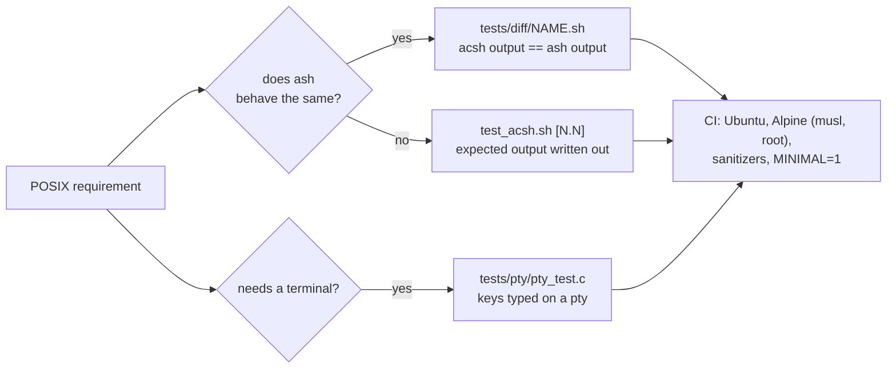
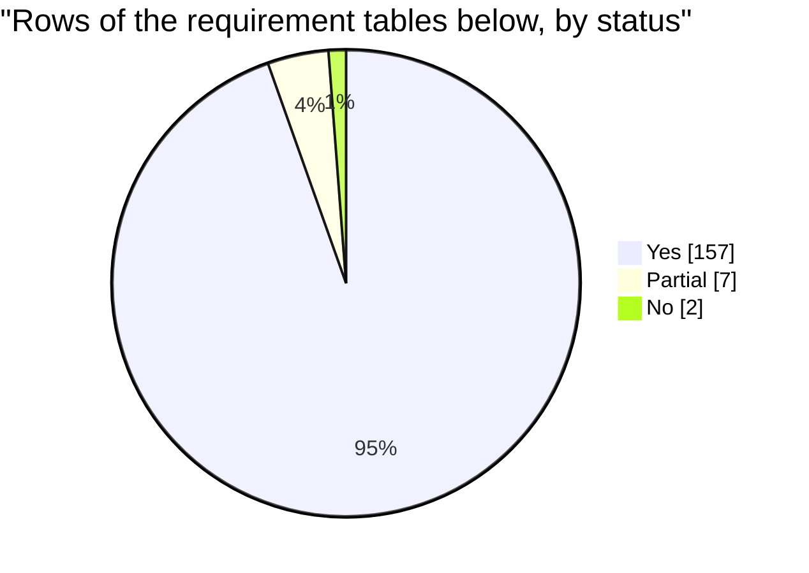
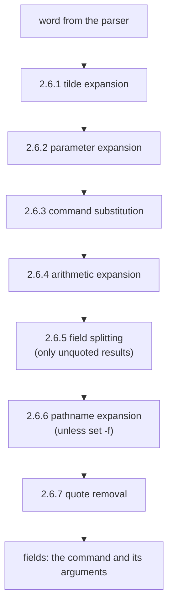
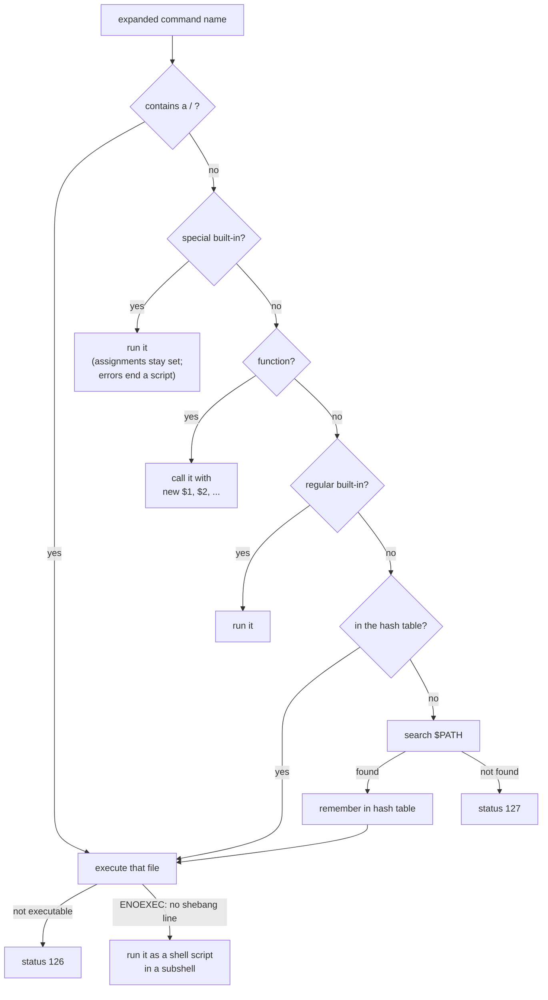
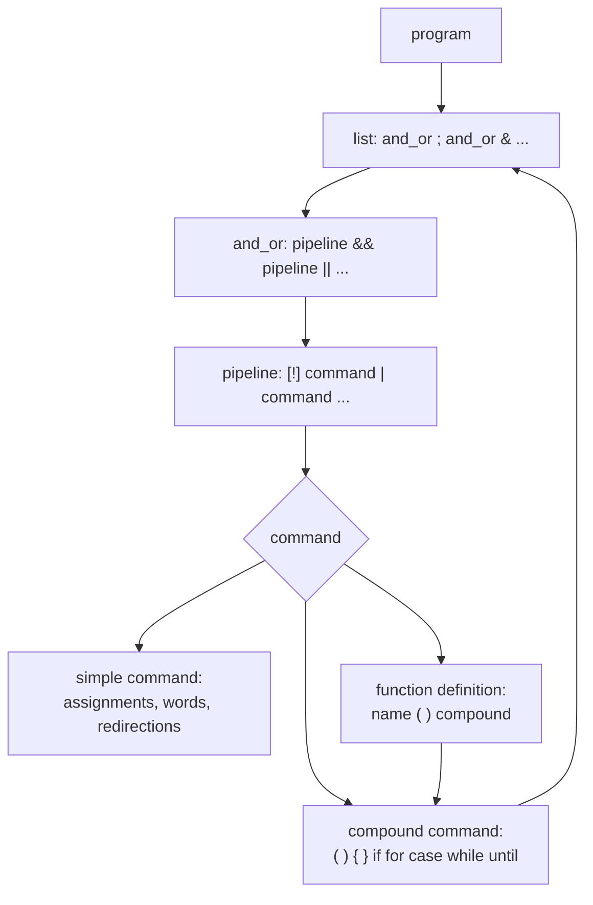
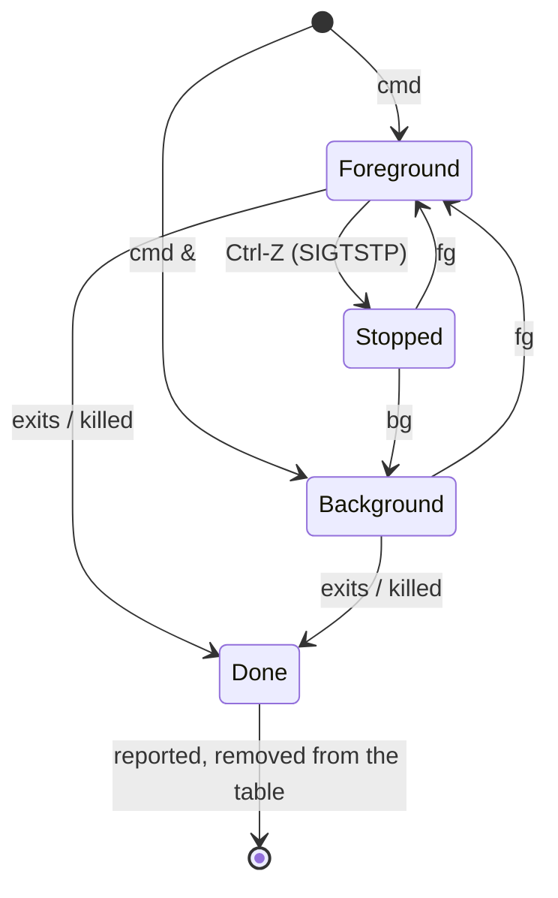
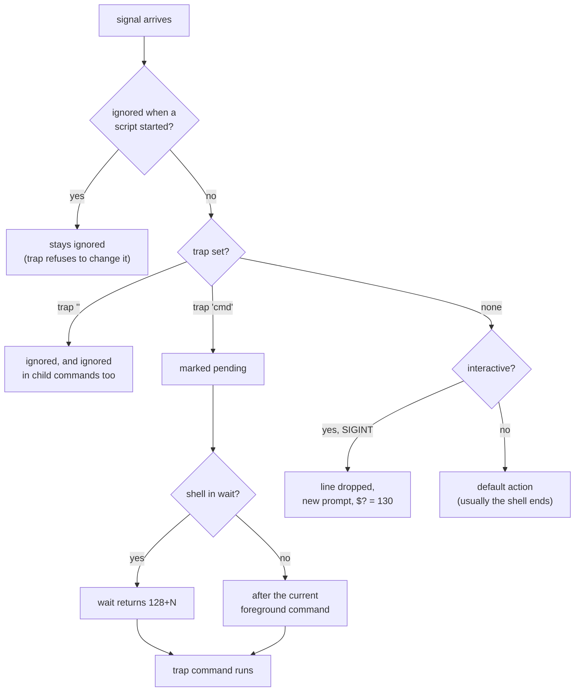

# acsh and POSIX

This document goes through the POSIX shell standard section by section
and gives, for each requirement, acsh's status and the tests that check
it. The reference is **POSIX.1-2024** (IEEE Std 1003.1-2024, Issue 8),
volume XCU: chapter 2, "Shell Command Language", and the shell-related
utilities. Section numbers below are those of the 2024 edition.

acsh's goal is to behave like BusyBox `ash`, which is itself a POSIX
shell. Where POSIX leaves a choice open, acsh does what `ash` does,
unless that is a known `ash` bug; each such case is stated.

---

## Contents

- [How to read this document](#how-to-read-this-document)
- [Summary](#summary)
- [2.2 Quoting](#22-quoting)
- [2.3 Token recognition and 2.3.1 alias substitution](#23-token-recognition-and-231-alias-substitution)
- [2.4 Reserved words](#24-reserved-words)
- [2.5 Parameters and variables](#25-parameters-and-variables)
- [2.6 Word expansions](#26-word-expansions)
- [2.7 Redirection](#27-redirection)
- [2.8 Exit status and errors](#28-exit-status-and-errors)
- [2.9 Shell commands](#29-shell-commands)
- [2.10 Shell grammar](#210-shell-grammar)
- [2.11 Job control](#211-job-control)
- [2.12 Signals and error handling](#212-signals-and-error-handling)
- [2.13 Shell execution environment](#213-shell-execution-environment)
- [2.14 Pattern matching notation](#214-pattern-matching-notation)
- [2.15 Special built-in utilities](#215-special-built-in-utilities)
- [Intrinsic and other built-in utilities](#intrinsic-and-other-built-in-utilities)
- [The sh utility: invocation](#the-sh-utility-invocation)
- [New in POSIX.1-2024](#new-in-posix1-2024)
- [Extensions beyond POSIX](#extensions-beyond-posix)
- [Where POSIX leaves a choice](#where-posix-leaves-a-choice)
- [Known gaps](#known-gaps)

---

## How to read this document

| Status | Meaning |
|---|---|
| **Yes** | implemented and tested |
| **Partial** | works, with the limits stated in the row |
| **No** | missing |

Tests are named in two ways:

- `name`: the script `tests/diff/name.sh`. `tests/run_diff.sh` runs it
  under acsh and under BusyBox `ash`, and requires the same standard
  output and the same exit status. These cover everything acsh shares
  with `ash`.
- `[N.N]`: a section of `test_acsh.sh`, which checks what a diff cannot:
  behaviour `ash` does not have, startup files, interactive behaviour
  through `-i`, and crash inputs.

`tests/pty` is the pseudo-terminal tester (`tests/pty/pty_test.c`),
which types keys into acsh. How the suites fit together:

---

## Summary

| Section | Yes | Partial | No |
|---|---|---|---|
| 2.2 Quoting | 5 | | |
| 2.3 Token recognition, aliases | 8 | | |
| 2.4 Reserved words | 2 | | |
| 2.5 Parameters and variables | 18 | 1 | |
| 2.6 Word expansions | 15 | | |
| 2.7 Redirection | 8 | | 1 |
| 2.8 Exit status and errors | 7 | | |
| 2.9 Shell commands | 19 | | |
| 2.10 Shell grammar | 4 | | |
| 2.11 Job control | 5 | 2 | |
| 2.12 Signals and error handling | 7 | | |
| 2.13 Shell execution environment | 4 | | |
| 2.14 Pattern matching | 5 | | |
| 2.15 Special built-ins and `set` | 30 | 3 | 1 |
| Intrinsic and other built-ins | 15 | | |
| The `sh` utility: invocation | 5 | 1 | |
| **Total** | **157** | **7** | **2** |

`set -m` and `set -b` are counted twice: under 2.11 and in the `set`
table. The "New in POSIX.1-2024" table repeats rows from the sections
and is not counted.

The two **No** items: file descriptors above 9 in redirections, and
`set -h`. The **Partial** items: locale support beyond `${#x}`,
`set -m`, `set -b`, `set -o vi`, and the status of `sh missing-file`. All are listed under
[Known gaps](#known-gaps).

---

## 2.2 Quoting

| Requirement | Status | Tests |
|---|---|---|
| 2.2.1 Backslash: quotes the next character; backslash-newline is removed (line continuation) | Yes | `grammar_quoting`, [2.2] |
| 2.2.2 Single quotes: everything literal up to the next `'` | Yes | `grammar_quoting`, [2.2] |
| 2.2.3 Double quotes: `$`, `` ` `` and `\` keep their meaning; `\` only before `$ ` `` ` `` `" \` and newline | Yes | `grammar_quoting`, `expand_misc` |
| 2.2.4 Dollar-single-quotes `$'...'` (new in 2024): `\n \t \r \a \b \f \v \\ \' \" \e \xHH \NNN \cX` | Yes; also bash's `\uHHHH` and `\UHHHHHHHH` (written as UTF-8) | `ash_extensions2`, [2.27] |
| Quoting is kept through expansion: a quoted result is never split or globbed | Yes | `expand_split`, `posix_misc` |

How quoting is kept: the lexer marks each quoted span with internal
bytes, and expansion carries a "quoted" flag on every character it
produces. Field splitting and pathname expansion only act on characters
without the flag, and quote removal is the last step. A side effect is
the known gap that the marker bytes `\x01 \x02 \x05 \x06` cannot appear
inside quoted text ([Known gaps](#known-gaps)).

---

## 2.3 Token recognition and 2.3.1 alias substitution

| Requirement | Status | Tests |
|---|---|---|
| Operators (`&& \|\| ;; ;& << >> <& >& <> <<- >\|` and the single-character ones) recognised greedily | Yes | `grammar_*`, `redirections_fd` |
| `IO_NUMBER`: a digit string directly before `<` or `>` | Yes | `redirections_fd` |
| `#` starts a comment only at the start of a word | Yes | `grammar_quoting`, `basics` |
| Here-document bodies read after the line that holds the operator; several on one line | Yes | `heredocs` |
| `$(...)`, `` `...` ``, `${...}` and `$((...))` read as one token, nested to any depth (up to 256), `case ... )` inside `$(...)` included | Yes | `expand_misc`, [2.4], [3.1] |
| Aliases replace the first word of a command, in scripts too | Yes | `script_aliases`, [2.19] |
| An alias value ending in a blank makes the next word an alias candidate too | Yes | `script_aliases` |
| An alias is not expanded again inside its own text (no infinite recursion); other aliases are | Yes | `script_aliases` |

---

## 2.4 Reserved words

| Requirement | Status | Tests |
|---|---|---|
| `! { } case do done elif else esac fi for if in then until while` recognised only where a reserved word may appear (first word, after `;` and the like, `in` and `do` in their places) | Yes | `grammar_compound`, `compound_after_semicolon` |
| Quoted reserved words are ordinary words (`"if"` runs a command named `if`) | Yes | `grammar_quoting` |

`function` and `[[ ]]`, reserved in `ash` and bash but left
unspecified by POSIX, are also recognised (see
[Extensions](#extensions-beyond-posix)).

---

## 2.5 Parameters and variables

| Requirement | Status | Tests |
|---|---|---|
| 2.5.1 Positional parameters `$1`…`$9`, `${10}` and above | Yes | `script_args`, `posix_misc` |
| 2.5.2 `$@` and `"$@"` (one field per parameter, none when there are none) | Yes | `script_args`, `function_args`, `expand_split` |
| `$*` and `"$*"` (joined with the first character of `IFS`) | Yes | `expand_split` |
| `$#`, `$?`, `$$` (the same in subshells), `$!`, `$0` | Yes | `script_args`, `expand_params`, `builtins_jobs` |
| `$-`: the current option letters | Yes | `set_options` |
| 2.5.3 `ENV`: expanded, then read by interactive shells only | Yes | [2.28] |
| `HOME`, `PWD` (set at startup, kept logical by `cd`), `OLDPWD` | Yes | `builtins_env` |
| `IFS`: reset to space, tab, newline at startup, never inherited | Yes | `builtins_env`, `expand_split` |
| `LINENO`, `PPID` | Yes | `ash_extensions`, `script_args` |
| `OPTIND`, `OPTARG` (see `getopts`) | Yes | `builtins_getopts` |
| `PATH` (`ash`'s default when unset), `CDPATH` | Yes | [2.28], `builtins_env` |
| `PS1` (expanded each time it is shown), `PS2`, `PS4` | Yes; `PS1` and `PS2` are never exported | `tests/pty` (prompt), `set_options` (PS4), `ash_extensions2` |
| `HISTFILE`, `HISTSIZE`, `FCEDIT` | Yes (plus bash's `HISTCONTROL`, `HISTIGNORE`) | [3.3], [4.7] |
| `LANG`, `LC_ALL`, `LC_CTYPE` | **Partial**: in a UTF-8 locale `${#x}` counts characters, and the line editor moves by character; patterns and field splitting work on bytes, as in `ash` | `ash_extensions2`, `tests/pty` |

Assignments and their scope:

| Requirement | Status | Tests |
|---|---|---|
| `NAME=value` assignments, expanded without splitting or globbing, tilde expanded after `=` and `:` | Yes | `expand_misc`, `vars_scope` |
| `NAME=value cmd`: the assignment lasts for `cmd` only (regular builtins, functions, programs) | Yes | `vars_scope`, `prefix_assign_pipe` |
| …but stays set after a special built-in | Yes | `posix_misc`, `vars_scope` |
| `$?` in an assignment-only command (`false; rc=$?` sets `rc=1`) and its own status (that of the last command substitution, else 0) | Yes | `status_exit_exec` |
| Assigning to a `readonly` variable is an error; a non-interactive shell exits with status 2 | Yes | `vars_scope` |

---

## 2.6 Word expansions

The order of the expansions, as POSIX gives it:

Steps 2.6.2 to 2.6.4 are done in one left-to-right pass over the word,
as POSIX asks. acsh's brace expansion (a bash extra, off with `set +B`)
runs before all of them, and only on unquoted braces.

| Requirement | Status | Tests |
|---|---|---|
| 2.6.1 `~` and `~user` at the start of a word, and after `=` and `:` in assignments | Yes | `expand_misc` |
| 2.6.2 `${x}` and `${x:-w}` `${x-w}` (default) | Yes | `expand_params` |
| `${x:=w}` `${x=w}` (assign default; an error for positional and special parameters) | Yes | `expand_params`, `expand_errors` |
| `${x:?w}` `${x?w}` (error if unset or null; a non-interactive shell exits) | Yes | `expand_errors`, `expand_errors2` |
| `${x:+w}` `${x+w}` (alternative value) | Yes | `expand_params` |
| `${#x}` (length) | Yes | `expand_params`, `ash_extensions2` |
| `${x%p}` `${x%%p}` `${x#p}` `${x##p}` (remove the shortest or longest suffix or prefix matching a pattern) | Yes | `expand_params` |
| `set -u`: expanding an unset parameter (other than `$@` and `$*`) is an error | Yes | `set_options` |
| 2.6.3 `$(...)` and backticks; trailing newlines removed; nested; `case` inside `$(...)` | Yes | `expand_misc`, `grammar_quoting`, [2.4] |
| 2.6.4 `$((...))`: signed long integers (64-bit), the C operators (`++` and `--`, which POSIX does not require, too), assignments `= += -= *= /= %= <<= >>= &= ^= \|=`, `?:`, `,` | Yes | `expand_arith`, `ash_extensions2` |
| Integer constants: decimal, octal `010`, hex `0x10` (and `ash`'s `N#digits`) | Yes | `expand_arith`, `bad_numbers` |
| Variables in arithmetic, unset ones as 0, values evaluated as expressions | Yes | `expand_arith`, `ash_extensions2` |
| Division by zero is an error; overflow wraps (as `ash` and bash), never a crash | Yes | `expand_errors`, [3.1] |
| 2.6.5 Field splitting: IFS whitespace collapses, other IFS characters delimit, empty `IFS` means no splitting, unset `IFS` means space-tab-newline | Yes | `expand_split`, `posix_misc` |
| 2.6.6 Pathname expansion: `* ? [...] [!...]`, classes `[[:alpha:]]` and the others; no match leaves the word; `.` files only when the pattern starts with `.`; `set -f` | Yes | `posix_misc`, `glob_many`, `set_options`, [2.6] |

Quote removal (2.6.7) is covered by every test above: `grammar_quoting`
checks it directly.

---

## 2.7 Redirection

| Requirement | Status | Tests |
|---|---|---|
| 2.7.1 `<` input, 2.7.2 `>` and `>\|` output (noclobber: `set -C` refuses to overwrite an existing regular file; `>\|` overrides) | Yes | `redirections_fd`, `set_options` |
| 2.7.3 `>>` append | Yes | `redirections_fd` |
| 2.7.4 Here-documents `<<` and `<<-` (tabs removed); a quoted delimiter makes the body literal, otherwise it is expanded like double-quoted text | Yes | `heredocs` |
| 2.7.5 `<&n`, 2.7.6 `>&n` duplicate; `<&-` `>&-` close | Yes | `redirections_fd` |
| 2.7.7 `<>` open for reading and writing | Yes | `redirections_fd` |
| Redirections apply left to right (`2>&1 >file` differs from `>file 2>&1`) | Yes | `redirections_fd` |
| A redirection on a compound command or function body applies to all of it | Yes | `grammar_functions`, `while_read_redirect` |
| A failed redirection: the command does not run, status 1 (a special built-in exits a non-interactive shell) | Yes | `redirect_fail`, `redirect_only` |
| File descriptors above 9 (`exec 10>file`) | **No**: rejected with an error, as `ash` does for some forms | — |

---

## 2.8 Exit status and errors

| Requirement | Status | Tests |
|---|---|---|
| 2.8.1 What a non-interactive shell does after an error: exits for a syntax error, a special built-in's error, a redirection error on a special built-in, an assignment error, an expansion error; continues otherwise | Yes | `expand_errors*`, `vars_scope`, `posix_misc`, `grammar_errors*` |
| An interactive shell never exits because of such an error | Yes | checked by hand (`-i`), against `ash` |
| Syntax errors: status 2 | Yes | `grammar_errors`, `grammar_errors2`, [2.26] |
| 2.8.2 Status 127 (command not found) and 126 (found, not executable) | Yes | `posix_misc` |
| 128+N for a command killed by signal N | Yes | `builtins_jobs`, `traps` |
| `exit N` uses N modulo 256; a bad number is an error | Yes | `exit_status_default`, `exit_bad_number` |
| A bare `exit` uses the last status (inside a trap: the status before the trap) | Yes | `exit_status_default`, `status_exit_exec` |

acsh's error messages name the file and the line (`acsh: script.sh:
line 4: ...`), and syntax errors also show the correct form of the
construct ([2.26], [1.4]). The status codes are the same as `ash`'s.

---

## 2.9 Shell commands

### 2.9.1 Simple commands

How a command name is looked up:

| Requirement | Status | Tests |
|---|---|---|
| Expansion of a simple command: assignments and redirections separated out, the rest expanded into fields | Yes | `basics`, `vars_scope` |
| A command with no name: assignments apply to the shell; redirections are performed and closed | Yes | `redirect_only`, `status_exit_exec` |
| Search order: special built-ins, functions, built-ins, then `PATH` | Yes | `posix_misc`, `command_v` |
| A file without `#!` that `exec` refuses (ENOEXEC) is run as a script | Yes | `posix_misc` |
| The exported variables, with the command's own assignments, form the child's environment (`exec` too) | Yes | `vars_scope`, `status_exit_exec` |

### 2.9.2 Pipelines, 2.9.3 lists

| Requirement | Status | Tests |
|---|---|---|
| `a \| b \| c`, each stage in a subshell; status of the last stage | Yes | [2.1], [2.20] |
| `! pipeline` negates the status | Yes | `grammar_compound` |
| `set -o pipefail` (new in 2024): the status of the last stage that failed | Yes | `set_options` |
| `;` and newline (sequential), `&` (asynchronous: `$!` set, standard input `/dev/null` without job control) | Yes | `amp_separator`, `background_quiet` |
| `&&` and `\|\|`, left-associative, equal precedence | Yes | [2.5] |

### 2.9.4 Compound commands

| Requirement | Status | Tests |
|---|---|---|
| `( list )` in a subshell; `{ list; }` in the current shell | Yes | `grammar_compound` |
| `for name [in words]; do list; done`, including `for x do` and an empty word list | Yes | `grammar_compound`, `posix_misc`, [2.9] |
| `case word in pattern) list;; esac`, with `(pattern)`, `\|` alternatives, and `;&` fall-through (new in 2024) | Yes | `grammar_compound`, [2.10], [2.27] |
| `if` / `elif` / `else` / `fi` | Yes | `grammar_compound`, [2.7] |
| `while` and `until` loops | Yes | `grammar_compound`, [2.8] |
| `break N`, `continue N` (N larger than the nesting: the outermost loop) | Yes | `loop_cap`, [2.11] |

### 2.9.5 Function definitions

| Requirement | Status | Tests |
|---|---|---|
| `name() compound-command [redirections]`; the redirections apply at each call | Yes | `grammar_functions`, `oneline_function` |
| Positional parameters replaced during the call and restored after | Yes | `function_args`, [2.12] |
| `return [N]`, also at the top of a sourced file; status of the last command otherwise | Yes | `return_cases`, `return_status`, `source_return` |

---

## 2.10 Shell grammar

acsh's parser is a hand-written recursive-descent parser that follows
the grammar of 2.10.2 rule by rule. The shape of what it builds:

| Requirement | Status | Tests |
|---|---|---|
| The grammar of 2.10.2, including newlines inside lists, `;` before `then`/`do` being optional after a newline, empty lines | Yes | `grammar_*`, `compound_after_semicolon` |
| Reserved words recognised only in the positions the rules allow | Yes | `grammar_compound` |
| Syntax errors detected before anything in that command runs (status 2) | Yes | `grammar_errors`, `grammar_errors2` |
| Very long lines and very deep nesting (100,000 levels) end in a clean error, not a stack overflow | Yes | `long_line`, [3.1] |

---

## 2.11 Job control

New as a section of its own in POSIX.1-2024.

| Requirement | Status | Tests |
|---|---|---|
| An interactive shell puts each job in its own process group and hands the terminal to the foreground job | Yes | [2.21], checked by hand on a terminal (`vi`, Ctrl-Z, `fg`) |
| Stopped jobs (Ctrl-Z, `SIGTSTP`), reported as `[1]+ Stopped ...`; terminal settings saved per job and restored | Yes | checked by hand on a terminal |
| `fg`, `bg`, `jobs` (`-l`, `-p`), `kill %job`, `wait %job` | Yes | `builtins_jobs` (`kill`, `wait`), [2.21] (`fg`), [4.7]; `bg` and `jobs` by hand |
| Job IDs `%n %+ %% %- %string %?string` | Yes | `builtins_jobs` (`%1`); the others by hand |
| Job state changes reported before the next prompt (scripts print none) | Yes | `background_quiet`; the prompt by hand |
| `set -m` / `set -o monitor` | **Partial**: accepted, but job control is on exactly when the shell is interactive | — |
| `set -b` / `set -o notify` | **Partial**: accepted; changes are still reported at the next prompt | `builtins_env` |

How a job moves between states:

---

## 2.12 Signals and error handling

| Requirement | Status | Tests |
|---|---|---|
| Signals ignored when a non-interactive shell starts stay ignored and cannot be trapped | Yes | [2.29] |
| Asynchronous commands ignore `SIGINT` and `SIGQUIT` when job control is off | Yes | [2.29] |
| An interactive shell ignores `SIGTERM` and `SIGQUIT`, and catches `SIGINT` (a new prompt) | Yes | `tests/pty` (Ctrl-C); the others by hand |
| A trap runs after the foreground command finishes, not during it | Yes | `traps` |
| A trapped signal interrupts `wait`, which returns 128+N; the trap then runs | Yes | `traps` |
| Commands inherit ignored signals (`trap '' INT`), and get default actions for trapped ones | Yes | [2.29], `traps` |
| `$?` inside a trap is the status before the trap; a bare `exit` there keeps it | Yes | `traps`, `status_exit_exec` |

What happens to a signal, step by step:

---

## 2.13 Shell execution environment

| Requirement | Status | Tests |
|---|---|---|
| A subshell gets a copy of: variables, functions, options, working directory, umask, open files, aliases | Yes | `vars_scope`, `traps`, [2.4] |
| In a subshell, traps with a command are reset to the default; ignored signals stay ignored | Yes | `traps` |
| Command substitution, pipeline stages and `( )` run in subshells; changes there do not reach the shell | Yes | [2.4], [2.20], `vars_scope` |
| `$$` is the main shell's process ID in every subshell | Yes | `script_args`, `traps` |

---

## 2.14 Pattern matching notation

Used by pathname expansion, `case`, and `${x#p}` and the related forms.

| Requirement | Status | Tests |
|---|---|---|
| `?` any character, `*` any string | Yes | `posix_misc`, `glob_many`, [2.10] |
| Bracket expressions `[abc]`, ranges `[a-z]`, `[!abc]` (and `[^abc]`) | Yes | `posix_misc` |
| Character classes `[[:alpha:]]`, `[[:digit:]]`, `[[:space:]]` and the others | Yes | `posix_misc`, [2.6] |
| A quoted or backslash-escaped pattern character matches itself | Yes | `posix_misc`, `grammar_quoting` |
| In pathname expansion: `/` and a leading `.` must be matched explicitly | Yes | `glob_many` |

Matching works on bytes, not characters, as in `ash` (see
[Known gaps](#known-gaps)).

---

## 2.15 Special built-in utilities

All of them are present: `break : continue . eval exec exit export
readonly return set shift times trap unset`. `type` reports each as "a
special shell builtin". What makes them special, and is tested:

| Rule | Status | Tests |
|---|---|---|
| Assignments before them stay set | Yes | `posix_misc`, `vars_scope` |
| An error in one (bad option, bad argument, failed redirection) ends a non-interactive shell | Yes | `posix_misc`, `vars_scope`, `redirect_fail` |
| They are found before functions of the same name | Yes | `posix_misc` |
| `.` searches `PATH` for a name without `/`; `return` leaves the file | Yes | `source_return` |

Details of each:

| Built-in | Supported | Tests |
|---|---|---|
| `break [n]`, `continue [n]` | Yes | `loop_cap`, [2.11] |
| `:` | Yes | `basics` |
| `. file [args]` | Yes (also as `source`); arguments become `$1`… for the file | `source_return` |
| `eval [args]` | Yes | [2.18] |
| `exec [cmd [args]]`, `exec` with only redirections (fds 0–9) | Yes | `redirections_fd`, `status_exit_exec` |
| `exit [n]` (EXIT trap runs first) | Yes | `exit_status_default`, `status_exit_exec` |
| `export [-p] [-n] name[=value]` | Yes | `vars_scope`, `builtins_env` |
| `readonly [-p] name[=value]` | Yes | `vars_scope` |
| `return [n]` | Yes | `return_cases`, `return_status` |
| `set` (see below) | Yes, except `-h` | `set_options`, `set_errexit`, `set_noexec` |
| `shift [n]` (an error when n is too big) | Yes | [2.16], `script_args` |
| `times` | Yes | `posix_misc` |
| `trap [action] [conditions]`, `trap -p [conditions]` (2024), listing | Yes | `traps`, [2.27] |
| `unset [-f\|-v] name` | Yes | `vars_scope` |

### `set`

| Option | Name | Status | Tests |
|---|---|---|---|
| `-a` | `allexport` | Yes | `set_options` |
| `-b` | `notify` | **Partial**: accepted; reported at the next prompt | `builtins_env` |
| `-C` | `noclobber` | Yes | `set_options` |
| `-e` | `errexit`: not in `if`/`while` conditions, `&&`/`\|\|` lists except the last, or `!` | Yes | `set_errexit` |
| `-f` | `noglob` | Yes | `set_options` |
| `-h` | (remember commands at definition) | **No**: `illegal option -h`, as in `ash`; commands are hashed when first run | — |
| `-m` | `monitor` | **Partial**: on exactly when interactive | — |
| `-n` | `noexec`: read but do not run (ignored when interactive) | Yes | `set_noexec` |
| `-u` | `nounset` | Yes | `set_options` |
| `-v` | `verbose` | Yes | `set_options` |
| `-x` | `xtrace`, prefixed with `$PS4` | Yes | `set_options` |
| | `ignoreeof`: Ctrl-D does not end an interactive shell | Yes | `tests/pty` |
| | `pipefail` (2024) | Yes | `set_options` |
| | `vi` | **Partial**: accepted; the line editor has emacs keys only | — |
| `-o`, `+o` | list the options, in a form that can be read back | Yes | `set_options` |
| `--`, `-` | set the positional parameters | Yes | `script_args`, [2.16] |

acsh's own: `-B` / `braceexpand` (brace expansion, on by default) and
`suggest` (history suggestions while typing, off by default).

---

## Intrinsic and other built-in utilities

POSIX.1-2024 calls these "intrinsic utilities": they must be built in
because they change the shell's own state.

| Utility | Supported | Tests |
|---|---|---|
| `alias`, `unalias [-a]` | Yes | [2.19], `script_aliases` |
| `bg`, `fg`, `jobs [-l\|-p]` | Yes | `builtins_jobs`, [2.21] |
| `cd [-L\|-P] [dir]`, `cd -`, `CDPATH` (the new directory printed when found through it) | Yes | `builtins_env` |
| `command [-p] [-v\|-V] cmd` | Yes; `-v` reports aliases, reserved words, functions, built-ins and paths, as `ash` | `command_v`, `builtins_env`, [1.6] |
| `fc [-r] [-e editor] [first [last]]`, `fc -l [-nr]`, `fc -s [old=new] [first]` | Yes | [3.3], [4.7] |
| `getopts optstring name [args]`: `OPTIND`, `OPTARG`, silent mode with a leading `:` | Yes | `builtins_getopts` |
| `hash [-r] [name]` | Yes | `posix_misc` |
| `kill [-s sig \| -sig] pid\|%job`, `kill -l [status]` | Yes | `builtins_jobs` |
| `read [-r] [-d delim] var...` (`-d` new in 2024; plus `-p -t -n -s -u`) | Yes | `builtins_io`, [2.14] |
| `type name...` | Yes | [1.6], `posix_misc` |
| `ulimit [-H\|-S] [-a] [-f -c -d -n -s -t -v ...] [limit]` | Yes | `posix_misc` |
| `umask [-S] [mask]`, octal and symbolic | Yes | `builtins_env` |
| `wait [pid\|%job ...]` | Yes | `builtins_jobs`, `traps` |
| `true`, `false`, `pwd [-L\|-P]` (built in, as in every shell) | Yes | `posix_misc`, `builtins_env` |
| `echo`, `printf`, `test` and `[` (built in, as in `ash`) | Yes | `builtins_io`, `test_builtin`, [2.13] |
| `newgrp` | not built in (no longer required in 2024); the system's `newgrp` runs | — |

---

## The sh utility: invocation

| Requirement | Status | Tests |
|---|---|---|
| `sh -c command_string [name [arg...]]`: `$0` = name | Yes | [2.22] |
| `sh file [arg...]`; a file that cannot be found: status 127 | **Partial**: the file runs; a missing one exits 2, as `ash` does | [2.22] |
| `sh -s [arg...]` and plain `sh`: commands from standard input | Yes | [2.22] |
| `-i` interactive; interactive by default when standard input and standard error are terminals | Yes | [2.22], `tests/pty` |
| Any `set` option letter on the command line (`-e`, `-x`, `+e`...) | Yes | `set_options` |
| A login shell (`-l`, or `argv[0]` starting with `-`) reads `/etc/profile` and `~/.profile` | Yes (an extension POSIX leaves open) | [2.23] |

---

## New in POSIX.1-2024

What the 2024 edition added to the shell, and where acsh stands:

| Addition | Status | Tests |
|---|---|---|
| `$'...'` dollar-single-quotes | Yes | `ash_extensions2`, [2.27] |
| `set -o pipefail` | Yes | `set_options` |
| `case` clauses ending in `;&` (fall through) | Yes (`ash` 1.37 rejects it) | [2.27] |
| `read -d delim` | Yes | `builtins_io` |
| `trap -p` with conditions | Yes (`ash` 1.37 rejects it) | [2.27] |
| Job control as its own section (2.11) | Yes, with the `set -m` limit | see [2.11](#211-job-control) |

---

## Extensions beyond POSIX

These are not required by POSIX. Each is either an `ash` extension
(so acsh must have it to be a drop-in), or a bash feature that acsh
adds; none changes the meaning of a valid POSIX script, except brace
expansion, which `set +B` turns off.

| Extension | From | Tests |
|---|---|---|
| `[[ ... ]]`, with `( )` grouping and string `<` `>` | `ash` (grouping: bash) | `test_builtin`, [1.5], [2.24] |
| `function name { ... }` | `ash` | `ash_extensions2` |
| `local` | `ash` | `vars_scope`, [2.15] |
| `${x:off:len}`, `${x/p/r}`, `${x//p/r}`, `${x/#p/r}`, `${x/%p/r}`, `"${@:n:m}"` | `ash` (anchors and `${@:n:m}`: fixed in acsh) | `ash_extensions*`, [2.25] |
| `$RANDOM`, `$EPOCHSECONDS`, `$EPOCHREALTIME` | `ash` | `ash_extensions*`, [2.28] |
| `**` in arithmetic, `N#digits` constants | `ash` | `expand_arith` |
| `<(...)`, `>(...)` process substitution | `ash` | `ash_extensions*` |
| `&>`, `&>>` | `ash` (`&>>`: bash) | `ash_extensions2`, [2.27] |
| `<<<` here-strings | bash | [3.6], `tests/bash_extras` |
| `{a,b}`, `{1..10..2}`, `{a..e}` brace expansion | bash | [3.6], `tests/bash_extras` |
| `printf %q` | bash | [3.6], `tests/bash_extras` |
| `let`, `source`, `help`, `chdir`, `history` | `ash` | `posix_misc`, [3.3] |
| `HISTCONTROL`, `HISTIGNORE`, bash's `PS1` escapes | bash | [3.3], `tests/pty` |

---

## Where POSIX leaves a choice

| Point | POSIX says | acsh does | `ash` does |
|---|---|---|---|
| A foreground command killed by `SIGINT` in a non-interactive shell | either is allowed | stops the script (as bash) | continues |
| Startup files of a login shell | unspecified | `/etc/profile`, `~/.profile` | the same |
| Startup files of an interactive shell besides `$ENV` | unspecified | `/etc/acshrc`, `~/.acshrc`, then `$ENV`, each at most once | `$ENV` only |
| `PS1`'s backslash escapes | unspecified | bash's set, plus `\g` and `\?` | busybox's subset |
| Arithmetic overflow | undefined | wraps around (64-bit) | wraps around |
| `echo` with backslashes or `-n` | implementation-defined | as `ash`: `-n` and `-e` understood | the same |

---

## Known gaps

| Gap | Effect | Plan |
|---|---|---|
| File descriptors above 9 in redirections | `exec 10>file` is rejected with an error | none; scripts for `ash` do not use them |
| `set -h` | not accepted | none; commands are hashed when first run, as `ash` |
| `set -m` | cannot be toggled; job control follows interactivity | open |
| `set -b` | accepted; changes still reported at the next prompt | open |
| `set -o vi` | accepted, does nothing; the editor has emacs keys | open |
| Locales | patterns and field splitting work on bytes (only `${#x}` and the editor know UTF-8), as in `ash` | none |
| `sh missing-file` | exits 2 (as `ash`); POSIX asks for 127 | none: scripts and tests for `ash` expect 2 |
| Bytes `\x01 \x02 \x05 \x06` | dropped from quoted text (`$'\x01'`): used internally as quote markers | none |

The interactive and size gaps that are not about POSIX (no vi mode,
the minimal build's size and memory against `ash`) are in the README,
under "What ash still does better".
